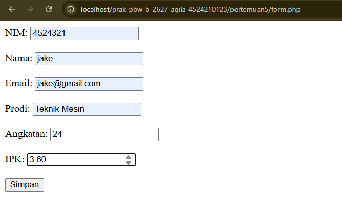
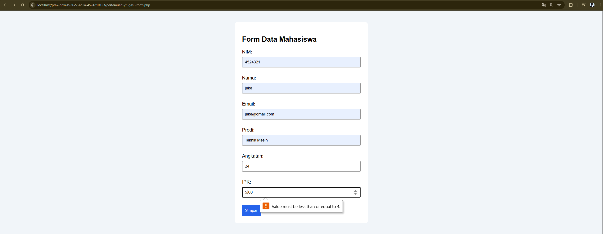
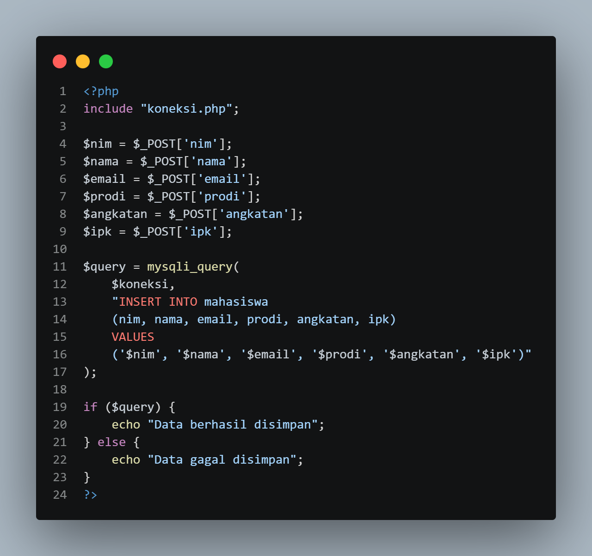
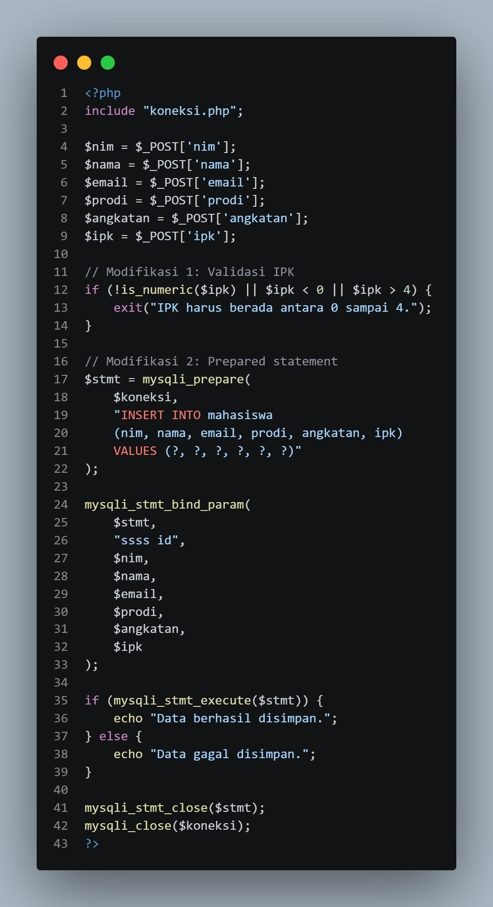

# Praktikum Pemrograman Berbasis Web - Tugas Pertemuan 5

## Deskripsi
Program ini merupakan aplikasi sederhana untuk mengelola data mahasiswa menggunakan PHP dan MySQL. Program terdiri dari file koneksi database, pengambilan data, form input, dan penyimpanan data.

## Identitas

| | |
|---|---|
| **Nama** | Raudha Hafsha Aqila |
| **NPM** | 4524210123 |
| **Program Studi** | Teknik Informatika |
| **Mata Kuliah** | Pemrograman Berbasis Web - B |

## 1. Modifikasi yang Dilakukan

### A. File form.php
1. Menambahkan styling CSS agar tampilan form lebih rapi.
2. Menambahkan batas nilai IPK dari 0 sampai 4.

### B. File simpan.php
1. Menambahkan validasi IPK agar hanya menerima angka dari 0 sampai 4.
2. Menggunakan prepared statement untuk meningkatkan keamanan query SQL.

## 2. Penjelasan Lima Bagian Kode
1. `$koneksi = mysqli_connect($host, $user, $pass, $dbname);` pada `koneksi.php` digunakan untuk menghubungkan PHP dengan database.
2. `$query = mysqli_query($koneksi, "SELECT * FROM mahasiswa");` pada `data.php` digunakan untuk mengambil data mahasiswa.
3. `<input type="number" name="ipk"
       min="0" max="4" step="0.01" required>` pada `form.php` dibatasi menggunakan atribut `min`, `max`, dan `step`.
4. `if (!is_numeric($ipk) || $ipk < 0 || $ipk > 4) {
    exit("IPK harus berada antara 0 sampai 4.");
}` pada `simpan.php` digunakan untuk memastikan IPK berada dalam rentang 0–4.
5. `$stmt = mysqli_prepare(
    $koneksi,
    "INSERT INTO mahasiswa
    (nim, nama, email, prodi, angkatan, ipk)
    VALUES (?, ?, ?, ?, ?, ?)"
);` pada `simpan.php` digunakan untuk menyiapkan query SQL dengan parameter.

## 3. Error dan Perbaikan
Error yang dibahas adalah `Unknown database 'akademik'`. Penyebabnya adalah database belum tersedia atau nama database tidak sesuai. Perbaikannya dilakukan dengan memeriksa database melalui phpMyAdmin dan memastikan nama database pada file koneksi sudah benar.

## 4. Screenshot
- Screenshot sebelum modifikasi form.
  
- Screenshot sesudah modifikasi form.
  
- Screenshot sebelum modifikasi simpan.
  
- Screenshot sesudah modifikasi simpan.
  

## 5. Kesimpulan
Melalui tugas ini, saya mempelajari cara memodifikasi form PHP, melakukan validasi IPK, menggunakan prepared statement, dan menghubungkan program PHP dengan database MySQL.
