# Praktikum Pemrograman Berbasis Web - Tugas Pertemuan 6

## Deskripsi
Program ini merupakan aplikasi pengelolaan data mahasiswa menggunakan PHP dan MySQL. Program memiliki fitur menampilkan, menambahkan, mengubah, mencari, dan menghapus data mahasiswa.

## Identitas

| | |
|---|---|
| **Nama** | Raudha Hafsha Aqila |
| **NPM** | 4524210123 |
| **Program Studi** | Teknik Informatika |
| **Mata Kuliah** | Pemrograman Berbasis Web - B |

## 1. Modifikasi yang Dilakukan

### A. index.php
1. Menambahkan fitur pencarian berdasarkan NIM atau nama.
2. Menampilkan pesan jika data tidak ditemukan.

### B. create.php
1. Membatasi panjang NIM maksimal 20 karakter.
2. Membatasi IPK dari 0 sampai 4.

### C. store.php
1. Menambahkan validasi format email.
2. Menggunakan prepared statement untuk menyimpan data.

### D. edit.php
1. Memeriksa ketersediaan parameter NIM.
2. Menggunakan prepared statement untuk mengambil data mahasiswa.

### E. update.php
1. Menambahkan validasi IPK dari 0 sampai 4.
2. Menggunakan prepared statement untuk memperbarui data.

### F. delete.php
1. Memeriksa ketersediaan parameter NIM.
2. Menggunakan prepared statement untuk menghapus data.

## 2. Penjelasan Lima Bagian Kode
1. `$keyword = trim($_GET['cari'] ?? '');` digunakan untuk mengambil kata kunci pencarian mahasiswa.
2. `<input type="number" name="ipk" min="0" max="4" step="0.01" required>` digunakan untuk membatasi input IPK.
3. `if (!filter_var($email, FILTER_VALIDATE_EMAIL)) {
    exit("Format email tidak valid.");
}` digunakan untuk memeriksa format email.
4. `"UPDATE mahasiswa
 SET nama = ?, email = ?, prodi = ?,
     angkatan = ?, ipk = ?
 WHERE nim = ?"` digunakan untuk memperbarui data mahasiswa berdasarkan NIM.
5. `"DELETE FROM mahasiswa WHERE nim = ?"` digunakan untuk menghapus data mahasiswa berdasarkan NIM.

## 3. Error dan Perbaikan
Error yang dibahas adalah `Undefined array key "nim"`. Error ini terjadi ketika program mengakses parameter NIM yang tidak tersedia. Perbaikannya adalah memeriksa keberadaan parameter sebelum digunakan dan menampilkan pesan jika NIM tidak ditemukan.

## 4. Screenshot
- Screenshot sebelum modifikasi index.
  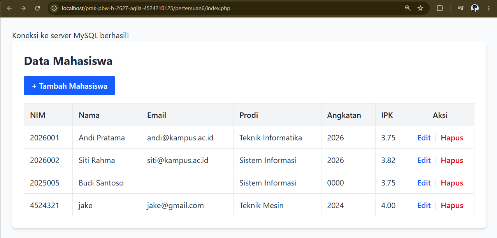
- Screenshot sesudah modifikasi index.
  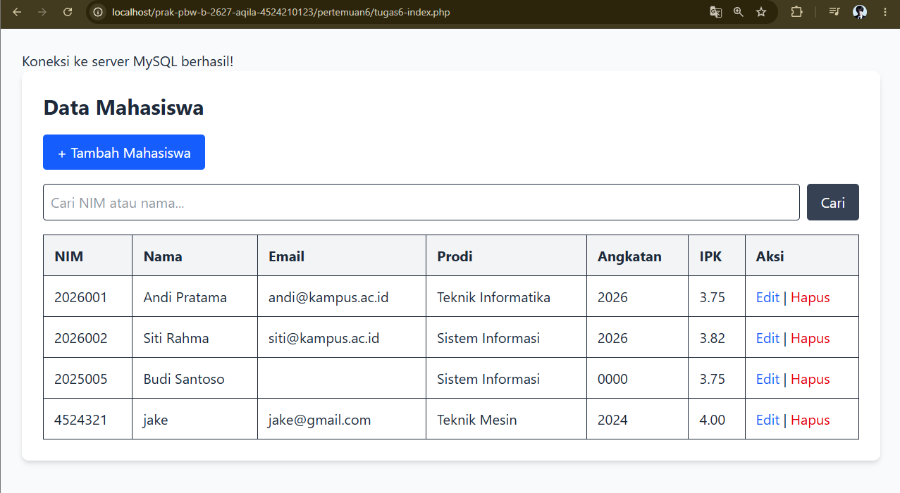
- Screenshot sebelum modifikasi create.
  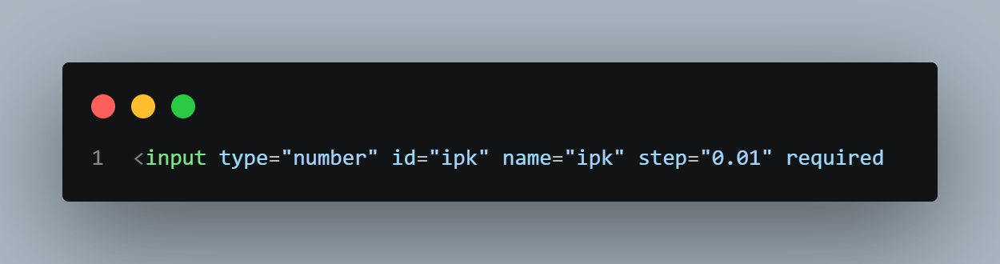
- Screenshot sesudah modifikasi create.
  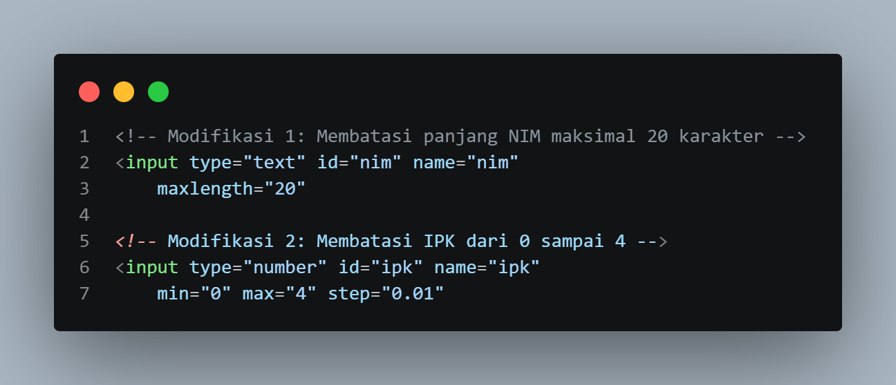
- Screenshot sebelum modifikasi store.
  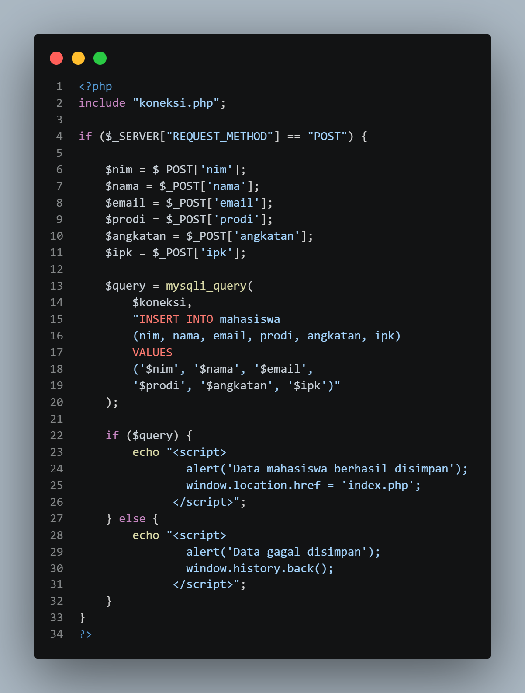
- Screenshot sesudah modifikasi store.
  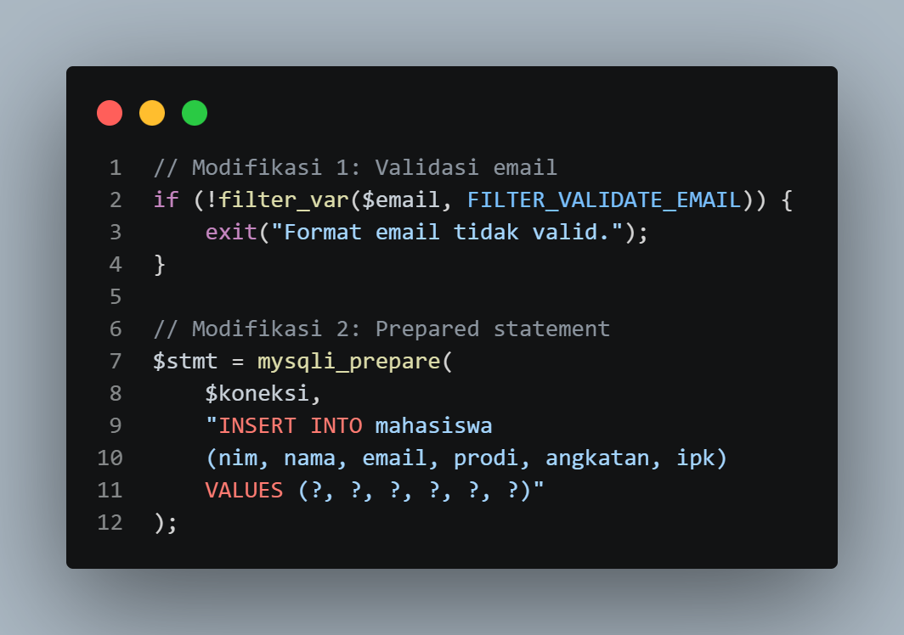
- Screenshot sebelum modifikasi edit.
  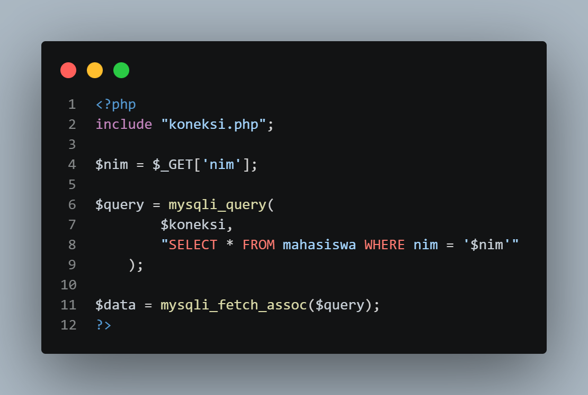
- Screenshot sesudah modifikasi edit.
  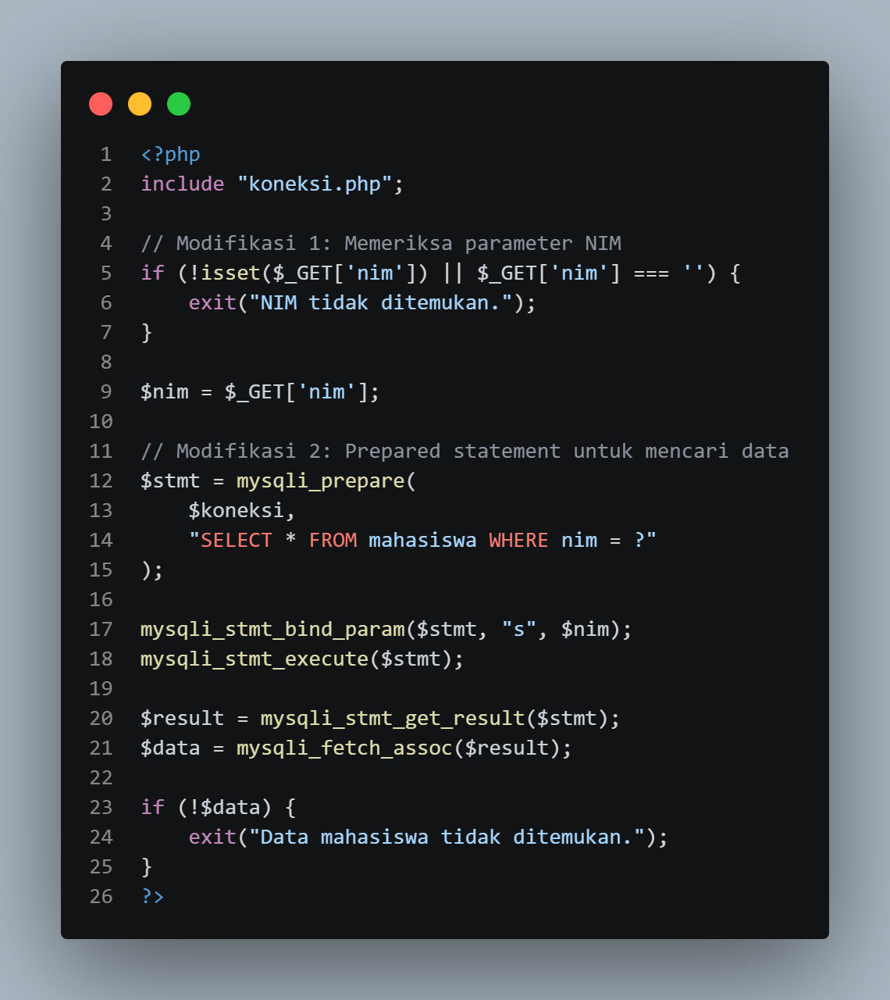
- Screenshot sebelum modifikasi update.
  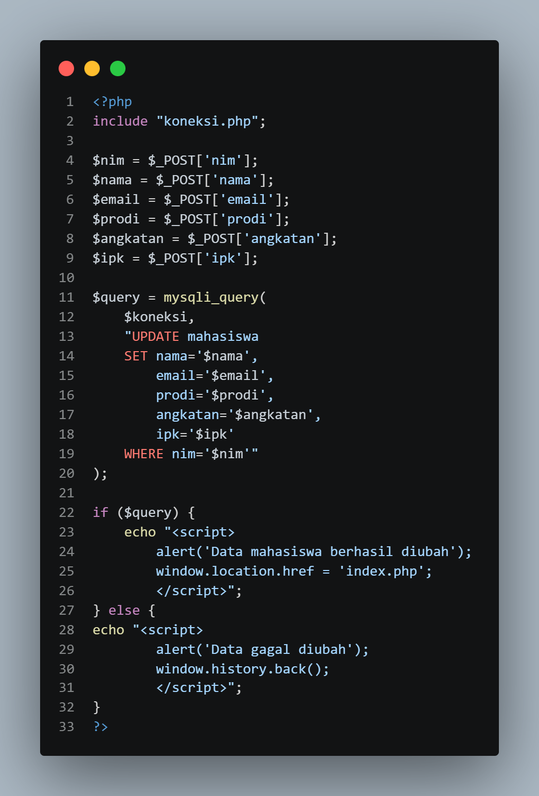
- Screenshot sesudah modifikasi update.
  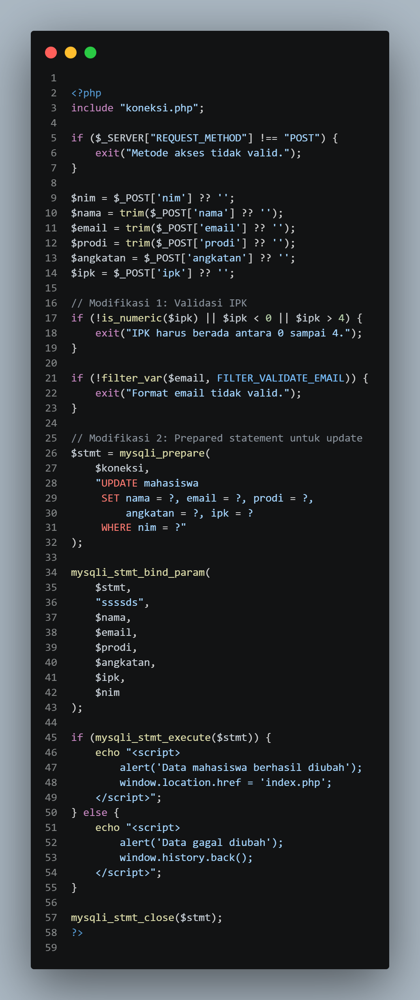
- Screenshot sebelum modifikasi delete.
  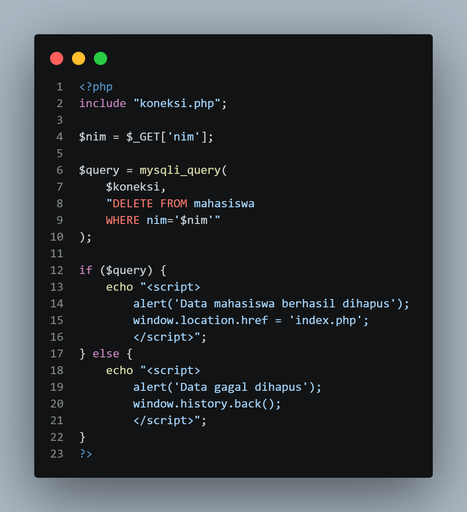
- Screenshot sesudah modifikasi delete.
  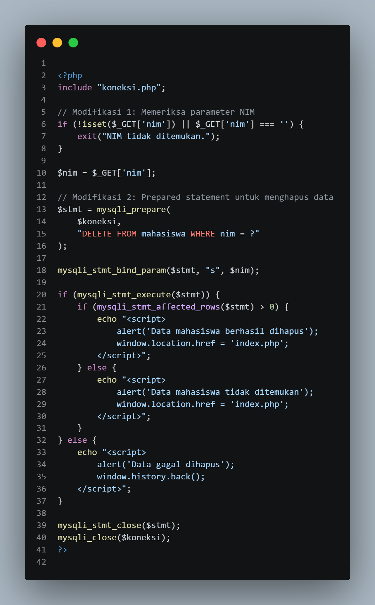

## 5. Kesimpulan
Melalui tugas ini, saya mempelajari pengelolaan data mahasiswa menggunakan PHP dan MySQL, validasi input, prepared statement, serta penerapan fitur CRUD dan pencarian data.
