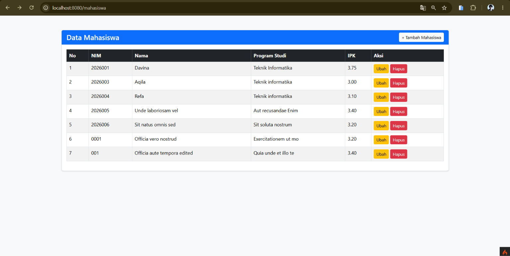
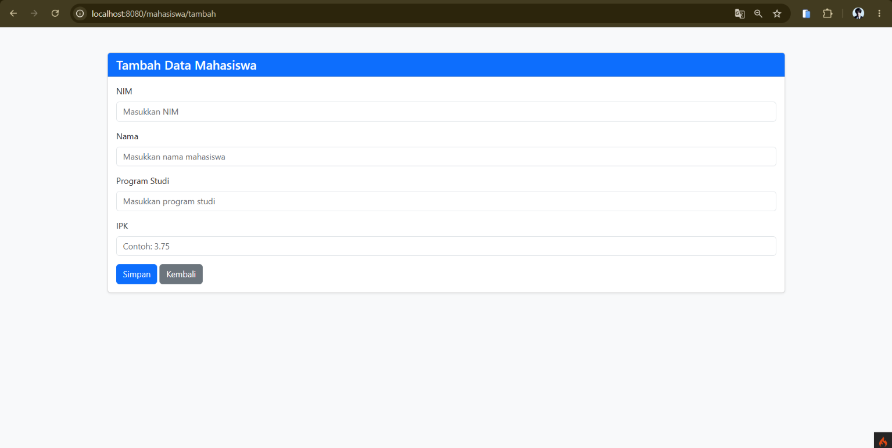
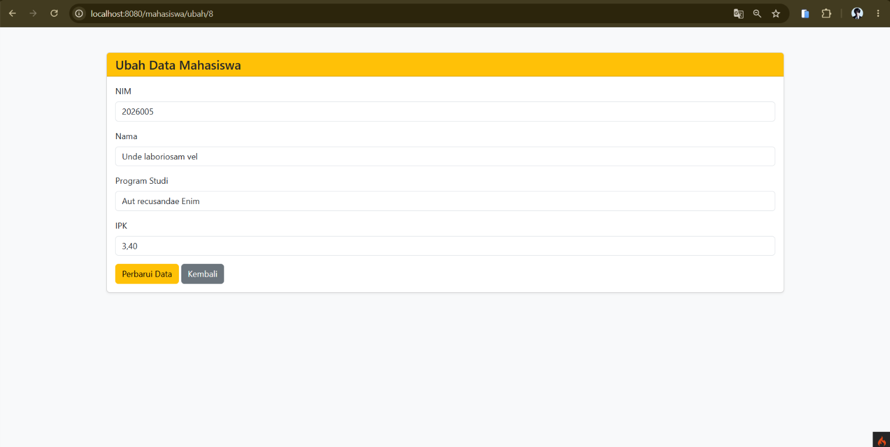
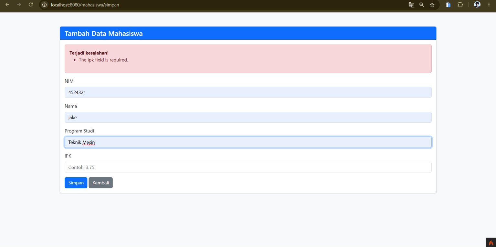
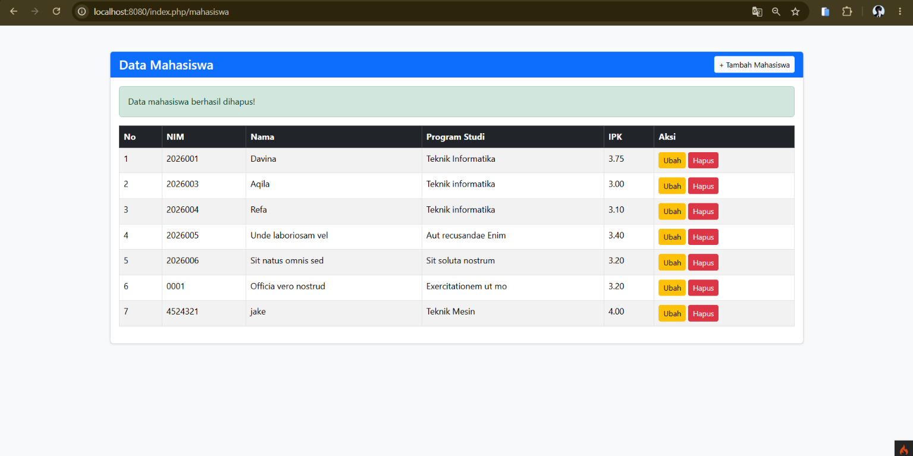

# Praktikum Pemrograman Berbasis Web - Tugas Kelompok Pertemuan 9

## 1. Identitas Kelompok
Raudha Hafsha Aqila        4524210123

## 2. Hasil Pengerjaan

### A. Tampilan Daftar Mahasiswa

**Penjelasan:**

Halaman daftar mahasiswa menampilkan seluruh data mahasiswa yang telah tersimpan di dalam database. Data ditampilkan dalam bentuk tabel yang berisi NIM, nama, program studi, dan IPK. Pada halaman ini juga tersedia tombol Tambah Mahasiswa, Ubah, dan Hapus untuk mengelola data mahasiswa.

### B. Tampilan Tambah Mahasiswa

**Penjelasan:**

Halaman tambah mahasiswa digunakan untuk memasukkan data mahasiswa baru melalui formulir yang telah disediakan. Pengguna mengisi NIM, nama, program studi, dan IPK, kemudian menekan tombol Simpan agar data tersimpan ke dalam database.

### C. Tampilan Ubah Mahasiswa

**Penjelasan:**

Halaman ubah mahasiswa digunakan untuk memperbarui data mahasiswa yang sudah tersimpan. Formulir akan menampilkan data sebelumnya sehingga pengguna dapat mengubah informasi mahasiswa, kemudian menyimpan perubahan tersebut.

### D. Tampilan Validasi Input Mahasiswa

**Penjelasan:**

Validasi input digunakan untuk memastikan data yang dimasukkan sesuai dengan aturan yang telah ditentukan. Validasi diterapkan menggunakan Validation Rules bawaan CodeIgniter 4.

Aturan validasi yang digunakan meliputi:

- `required`: memastikan kolom wajib diisi.
- `min_length`: menentukan panjang minimal karakter.
- `max_length`: menentukan panjang maksimal karakter.
- `is_unique`: memastikan NIM tidak digunakan oleh mahasiswa lain.
- `numeric`: memastikan IPK berupa angka.
- `greater_than_equal_to`: memastikan IPK minimal 0.
- `less_than_equal_to`: memastikan IPK maksimal 4.

Apabila data yang dimasukkan tidak sesuai dengan aturan, sistem akan menampilkan pesan kesalahan agar pengguna dapat memperbaikinya.

### E. Tampilan Hasil Hapus Mahasiswa

**Penjelasan:**

Fitur hapus digunakan untuk menghapus data mahasiswa yang sudah tersimpan di dalam database. Sebelum penghapusan dilakukan, sistem menampilkan konfirmasi kepada pengguna. Setelah proses berhasil, data mahasiswa yang dipilih tidak lagi muncul pada halaman daftar mahasiswa dan sistem menampilkan hasil penghapusan.

## 3. Implementasi CRUD dan Validasi

Implementasi fitur pada aplikasi terdiri dari:

- **Create:** Menambahkan data mahasiswa baru ke dalam database.
- **Read:** Menampilkan seluruh data mahasiswa dalam bentuk tabel.
- **Update:** Mengubah informasi mahasiswa yang sudah tersimpan.
- **Delete:** Menghapus data mahasiswa dari database.
- **Validation:** Memeriksa input menggunakan Validation Rules CodeIgniter 4 dan menampilkan pesan kesalahan pada view.

## 4. Kesimpulan

Berdasarkan hasil praktik yang telah dilakukan, modul pengelolaan data mahasiswa menggunakan CodeIgniter 4 berhasil dibuat dengan menerapkan fungsi CRUD, mulai dari menambahkan, menampilkan, mengubah, hingga menghapus data mahasiswa.

Selain itu, validasi input menggunakan Validation Rules CI4 berhasil diterapkan untuk memastikan data yang dimasukkan sesuai dengan ketentuan. Pesan kesalahan juga dapat ditampilkan pada halaman formulir apabila terdapat input yang tidak valid.

Melalui praktik ini, dapat dipahami penerapan konsep Model, View, Controller (MVC), routing, pengelolaan database, serta validasi input dalam pengembangan aplikasi berbasis web.