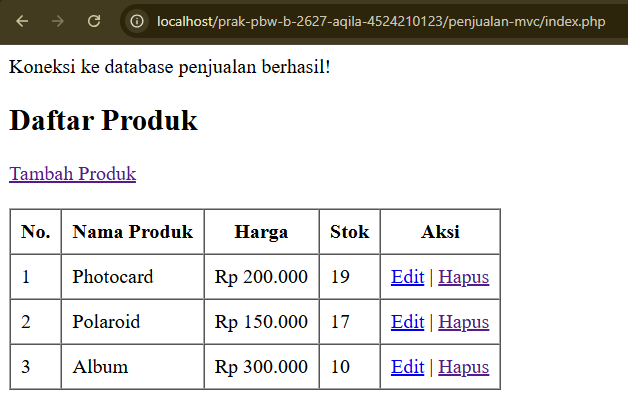
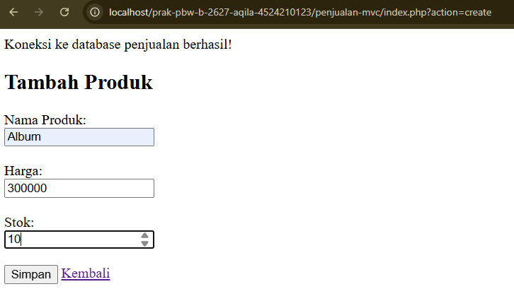
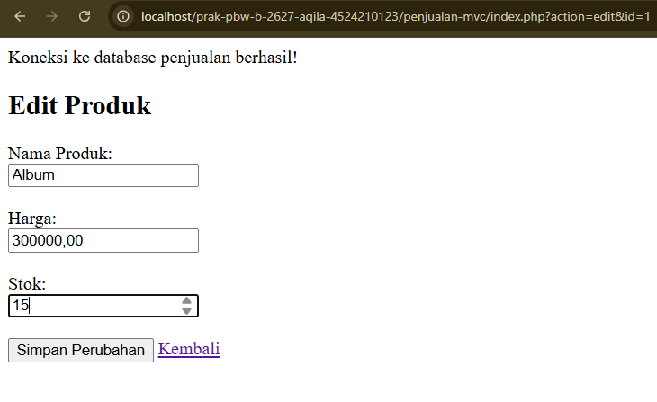
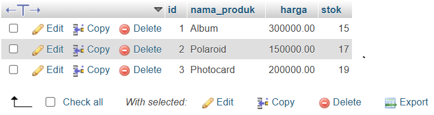

# Praktikum Pemrograman Berbasis Web - Tugas Pertemuan 7

## DESKRIPSI

Program ini merupakan aplikasi penjualan produk sederhana menggunakan PHP dan MySQL dengan konsep MVC (*Model, View, Controller*). Program memiliki fitur untuk menambahkan produk, menampilkan daftar produk, mengedit data produk, dan menghapus produk. Data produk terdiri dari nama produk, harga, dan stok yang disimpan dalam database MySQL.

## IDENTITAS

| | |
|---|---|
| **Nama** | Raudha Hafsha Aqila |
| **NPM** | 4524210123 |
| **Program Studi** | Teknik Informatika |
| **Mata Kuliah** | Pemrograman Berbasis Web - B |

## HASIL TUGAS

1. **Halaman daftar produk**

   Menampilkan daftar produk beserta harga, stok, dan tombol aksi untuk mengedit atau menghapus produk.

   

2. **Form tambah produk**

   Menampilkan form untuk memasukkan nama produk, harga, dan stok sebelum disimpan ke database.

   

3. **Form edit produk**

   Menampilkan form yang berisi data produk yang sudah ada dan dapat diubah oleh pengguna.

   

4. **Data produk pada database**

   Menampilkan data produk yang tersimpan pada tabel `produk` di database `penjualan_db` melalui phpMyAdmin.

   


## PENJELASAN LIMA BAGIAN KODE

1. **Koneksi database pada `koneksi.php`**

   ```php
   $koneksi = mysqli_connect(
       $host, $user, $pass, $dbname
   );
   ```

   Kode ini digunakan untuk menghubungkan program PHP dengan database MySQL.

2. **Mengambil data produk pada `models/ProdukModel.php`**

   ```php
   public function getAll() {
       return mysqli_query(
           $this->db,
           "SELECT * FROM produk ORDER BY id DESC"
       );
   }
   ```

   Fungsi `getAll()` digunakan untuk mengambil seluruh data produk dari tabel `produk` dan mengurutkannya berdasarkan ID secara menurun.

3. **Menambahkan produk pada `models/ProdukModel.php`**

   ```php
   $stmt = mysqli_prepare(
       $this->db,
       "INSERT INTO produk (nama_produk, harga, stok)
        VALUES (?, ?, ?)"
   );
   ```

   Kode ini menyiapkan query untuk menyimpan nama produk, harga, dan stok ke dalam database menggunakan prepared statement.

4. **Menampilkan daftar produk pada `views/produk/index.php`**

   ```php
   <?php $no = 0; ?>

   <?php while ($row = mysqli_fetch_assoc($data)) : ?>
       <td><?= ++$no ?></td>
   <?php endwhile; ?>
   ```

   Kode ini digunakan untuk menampilkan nomor urut produk pada halaman website. Nomor akan dimulai kembali dari 1 pada setiap tampilan halaman, tanpa mengubah ID asli produk di database.

5. **Mengatur proses program pada `index.php` utama**

   ```php
   $action = $_GET['action'] ?? 'index';

   switch ($action) {
       case 'create':
           $controller->create();
           break;

       case 'edit':
           $controller->edit();
           break;

       case 'hapus':
           $controller->hapus();
           break;

       default:
           $data = $controller->index();
           require __DIR__ . '/views/produk/index.php';
           break;
   }
   ```

   Kode ini menentukan proses yang dijalankan berdasarkan parameter `action`, seperti menampilkan daftar produk, menambahkan produk, mengedit produk, dan menghapus produk.

## KESIMPULAN

Melalui tugas ini, saya mempelajari penerapan konsep MVC dalam pembuatan aplikasi berbasis PHP dan MySQL. Saya memahami bahwa Model bertugas mengelola data dan berinteraksi dengan database, View menampilkan halaman kepada pengguna, sedangkan Controller mengatur alur program dan menghubungkan Model dengan View. Program ini juga memberikan pemahaman mengenai operasi tambah, tampil, edit, dan hapus data produk serta penggunaan prepared statement untuk meningkatkan keamanan query SQL.
